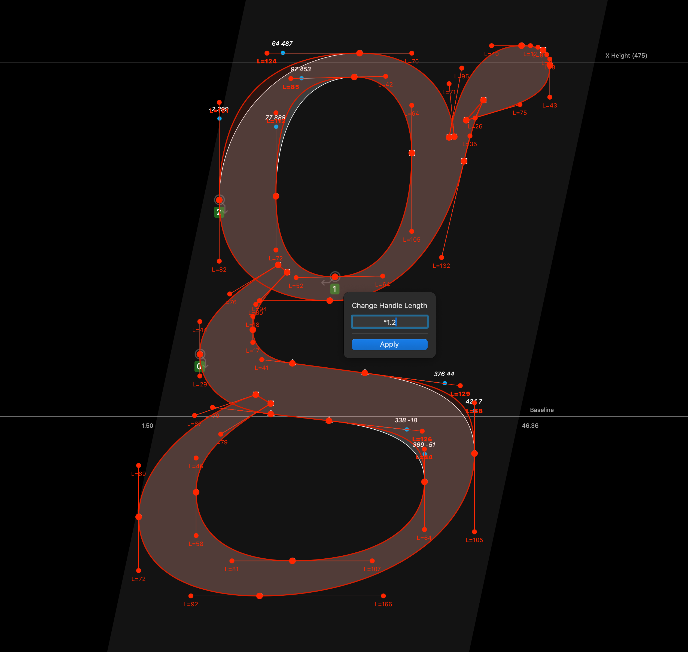

# Handler

A RoboFont extension for viewing and manipulating off-curve handle lengths.

## Usage

1. **Download the extension** from this repository’s [Releases](https://github.com/ryanbugden/Handler/releases) page.
2. **Install the extension** in RoboFont by double-clicking the extension file or dragging the file onto the RoboFont app icon.
3. **Select on-curve and/or off-curve points.** Selecting an on-curve includes its associated off-curves. RoboFont’s highlighting shows what’s included.
4. **Check the handle lengths.** Each selected off-curve displays its handle length below the point, for example, `L=10`.
5. Run **Handler** to adjust the lengths of selected off-curve handles.

      *Note: You can set a keyboard shortcut for Handler through RoboFont’s preferences:* 
      `Preferences > Short Keys > Extensions > Handler > Handler`

      | Input | Effect                    |
      | ----- | ------------------------- |
      | `2`   | Add 2 units               |
      | `-2`  | Subtract 2 units          |
      | `=2`  | Set the length to 2 units |
      | `*2`  | Multiply by 2             |
      | `/2`  | Divide by 2               |

6. **Refine the value** using ↑ and ↓ arrow keys. Hold ⇧ for increments of `10` or ⇧⌘ for increments of `100`. Any leading operator (`=`, `*`, or `/`) stays unchanged.

7. **Review** the preview.

8. **Click Apply** to commit the changes.

## Acknowledgements

This extension was sponsored by Mathieu Christe ([La Police](https://lapolice.ch/)) in 2026.

Looking for similar RoboFont extensions? Check out [Measure Handles Tool](https://github.com/johannesbreyer/HandleLength), by Johannes Breyer.

## License

Please see the license included in [build.yaml](build.yaml).